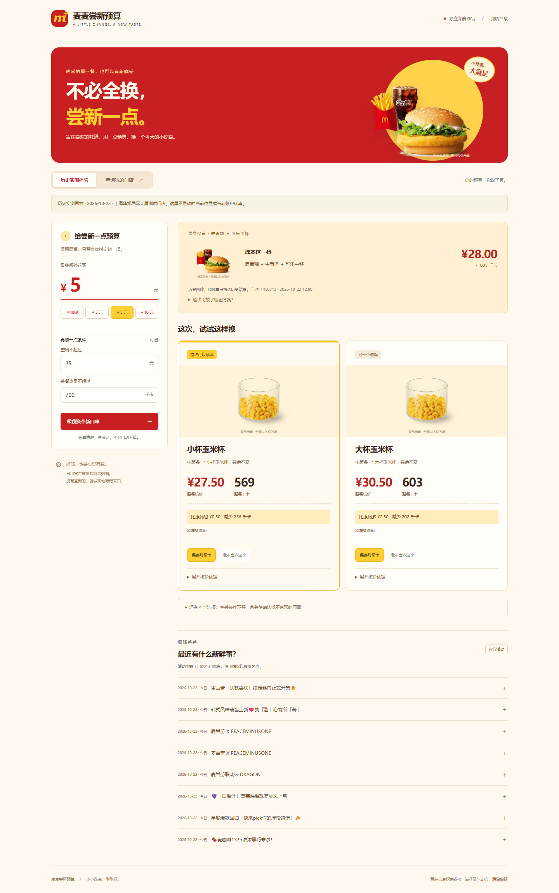

# 麦麦尝新预算

**今天，只换一样。** 给熟悉的一餐留一点新鲜感：保留喜欢的主食，指定只换小食或饮料，在额外预算内一起比较套餐、单点、优惠、活动与热量。

面向想尝试不同口味，又不想重新搭配整餐的到店自取顾客。交付形态是可安装 AI Skill、零依赖 Node 工具和本地网页。独立参赛作品，不代表麦当劳官方。

## 界面预览



[手机端截图](docs/mobile.png) · [对照卡示例](docs/share-card.png)

## 30 秒体验

需要 Node.js **22 或以上**。无需 npm install。

```sh
node scripts/server.mjs
```

打开 <http://127.0.0.1:8768>。默认展示 **2026-10-22 真实 MCP 历史回放**，修改预算只筛选该历史结果，绝不是当前报价。命令行回放：`node scripts/cli.mjs demo`。

实时模式在启动服务前设置进程环境变量 `MCD_MCP_TOKEN`。PowerShell 可以隐藏输入，避免凭证进入命令历史：

```powershell
$secret = Read-Host '输入自己的麦当劳 MCP Token' -AsSecureString
$env:MCD_MCP_TOKEN = [System.Net.NetworkCredential]::new('', $secret).Password
try { node scripts/server.mjs } finally { Remove-Item Env:MCD_MCP_TOKEN }
```

浏览器点击“查询我的门店”，输入城市/地标，选门店和时间，再选原套餐、唯一想换的一项及额外预算。凭证只在本机服务进程使用。`.env.example` 只是变量说明，程序不会自动读取 `.env`。网页不收集 Token。

## 安装为 Skill

把整个 `maimai-taste-budget` 文件夹复制到支持标准 `SKILL.md` 的宿主技能目录；Codex 可用 `$CODEX_HOME/skills/maimai-taste-budget`（默认 `~/.codex/skills/maimai-taste-budget`）。保留 scripts、examples 等相对路径，刷新宿主技能发现。配置宿主可访问的 Node 22+ 和环境变量，不要把真实凭证写进 Skill。宿主是否自动加载须在对应宿主验证。

示例请求：“用麦麦尝新预算，在上海人民广场附近，我原来想吃麦香鸡套餐，只换小食，最多多花五元，整餐不超过七百千卡。”Skill 会查真实门店，不把示例位置当成用户位置。

## 一次真实结果

2026-10-22，上海华旭国际大厦测试门店，预约当日 12:00：

| 对照 | 整餐官方核价 | 整餐热量 | 相对原餐 |
|---|---:|---:|---|
| 麦香鸡 + 中薯条 + 可乐中杯 | 28.00 元 | 805 千卡 | 原餐 |
| 仅换成小杯玉米杯 | 27.50 元 | 569 千卡 | 少 0.50 元、少 236 千卡 |
| 仅换成大杯玉米杯 | 30.50 元 | 603 千卡 | 多 2.50 元、少 202 千卡 |

新品小食能核价但缺官方营养数据，归入“营养待确认”，不会冒充七百千卡以内。结果仅用于证明真实链路，不能作为其他门店/日期的价格承诺。完整脱敏记录见 [examples/verified-report.json](examples/verified-report.json)。

## 为什么不是另一个万能推荐器

原餐是参照物，只允许一项变化。用户看到的是“为这次尝试多花多少”，而不是一长串重新搭配的套餐。官方上新优先展示，但也允许用户尝试自己不熟悉的普通餐品；不凭空断言用户从未吃过。顾客可以本机标记“不喜欢”、清除偏好、保存不含账户信息的对照卡。

活动、优惠和热量在同一决策中呈现，但不会为了活动强推加购，不把宣传价当成交价，不拿缺失营养凑达标。

## 能力边界

- 单人到店自取、可逐项选配套餐，每轮一份；不支持外送、多人任选多份或自动下单。
- 每次最多比较当前轮 12 个候选；每条餐品路径最多 6 个适用单券方案。不是全菜单、全部券叠加穷举，不保证全局最低价。
- 营养精确匹配官方餐品名称与份量；未知或冲突一律显示未知。热量仅供饮食信息参考。
- 本机单用户服务，只监听 127.0.0.1；不要部署成共享个人账户的公网服务。
- 页面关闭不会保存账户查询结果；只把主动标记的不喜欢保留在 localStorage，可一键清除。

## 测试与参赛

```sh
node --test test/*.test.mjs
node scripts/check.mjs
node scripts/cli.mjs probe
```

25 项自动化测试及独立浏览器回归已通过。前两项不需要凭证；probe 是真实连接检测。测试、真实 MCP 与浏览器验收分别见 [docs/verification.md](docs/verification.md)。接入说明见 [MCP_INTEGRATION.md](MCP_INTEGRATION.md)，配置示例见 [mcp-config.example.json](mcp-config.example.json)。

官方声明保留原文：[CONTEST_DECLARATION.md](CONTEST_DECLARATION.md)。[参赛检查表](docs/contest-checklist.md) 与 [报名草稿](docs/submission.md) 不代表已经报名。正式参赛还须个人公开 GitHub 仓库、规定期限内提交 Issue 并得到系统成功回复。

餐品图片来自官方 MCP 菜单返回的 `menu-img.mcd.cn` 链接，由浏览器直接加载。原餐及候选图仅作示意，份量以名称为准；通用玉米杯图片可用于不同杯型，未用图片推断营养。图片缺失或离线时保留文字推荐。红黄视觉不代表官方背书。

当前网页调整预算和热量时，会立即筛选本次报价，不反复调用 MCP；需要刷新价格时点击主按钮。每个核价结果的比较范围可展开查看。手机体验复查与可选浏览器回归方法见 `docs/verification.md`。

## 开源与素材

原创代码采用 [MIT License](LICENSE)。官方餐品图、商标、数据和声明不受本项目 MIT 许可再授权，见 [第三方来源说明](THIRD_PARTY_NOTICES.md)。
